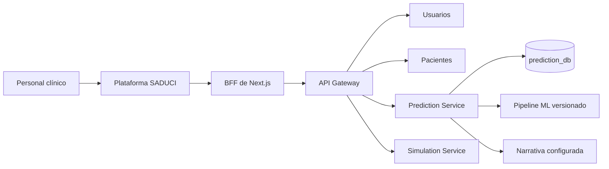
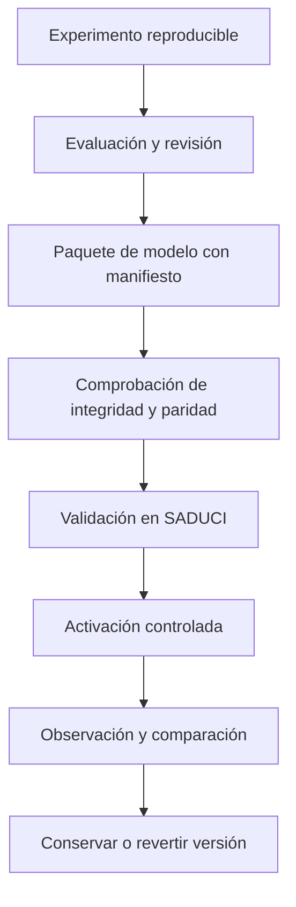

# Informe y planificación de integración y actualización con SADUCI

Fecha: 9 de noviembre de 2026.

Repositorios examinados: `Intensive-Care-Hidden-Mortality` y `../saduci`.

## 1. Dictamen

La integración básica del modelo ya existe. SADUCI dispone de un servicio de predicción, contratos compartidos, persistencia, explicaciones y generación de narrativas. Además, su copia de `new_workflow.joblib` es idéntica a la de este repositorio. El trabajo recomendado consiste en consolidar esa integración, corregir diferencias semánticas y establecer un proceso reproducible para futuras actualizaciones.

Se propone mantener este repositorio como espacio de investigación y entrenamiento y SADUCI como sistema de ejecución y ayuda a la valoración clínica. Las nuevas versiones se transferirían como paquetes de modelo verificables, con sus contratos y evidencia de evaluación. La interfaz asistencial seguiría siendo la de SADUCI.

Este documento es una planificación técnica. No modifica los servicios de SADUCI, no despliega modelos y no acredita validación clínica. Se complementa con [Summary2026.md](Summary2026.md), que recoge el trabajo experimental de origen.

## 2. Alcance y método de revisión

Se inspeccionaron las instrucciones, documentación arquitectónica y fuentes del servicio de predicción de SADUCI, junto con sus contratos, carga de modelos, generación narrativa, configuración, entidades y pruebas relacionadas. Se utilizó el índice de código para localizar símbolos y trazar el recorrido de explicación. Las rutas principales consultadas presentan coincidencia de metadatos con el índice; la comprobación de cobertura es indicativa y no garantiza exhaustividad.

Se compararon los artefactos mediante SHA-256. No se deserializaron modelos ni se ejecutaron entrenamiento, pruebas del backend, pruebas de interfaz, contenedores o servicios de lenguaje. La revisión del frontend se limita a documentación y localización de puntos de llamada; su comportamiento interactivo deberá verificarse durante la implementación.

El punto de referencia de SADUCI es el commit `0553b3b`, del 6 de noviembre de 2026. Su árbol de trabajo ya tenía una modificación en `apps/core/compose.yaml`. Las observaciones sobre Compose describen el archivo local examinado y deberán contrastarse con la versión que finalmente se integre.

## 3. Estado comprobado de la integración

### 3.1. Modelo ya compartido

Los siguientes archivos tienen el mismo SHA-256:

- `new_workflow.joblib` en este repositorio.
- `../saduci/apps/core/src/prediction/models/v1/new_workflow.joblib`.

```text
b58bcf14ff4ad023c608861323bcabca5fa5d9250058af9f1ed1d0e1cf1923ad
```

La identidad binaria elimina la necesidad de una primera copia o conversión del modelo. No demuestra que ambos entornos produzcan resultados iguales, ya que aún deben verificarse versiones, transformaciones y entradas.

### 3.2. Topología que debe conservarse

La arquitectura documentada de SADUCI utiliza una plataforma Next.js y servicios FastAPI, con un gateway como frontera común. Cada servicio de datos conserva su propia base PostgreSQL.



La integración de mortalidad pertenece a `Prediction Service`, en el puerto interno 7003. El navegador debe seguir accediendo por el BFF y el gateway. No se propone añadir un acceso directo a Streamlit ni conectar el navegador al servicio interno.

Referencia: [arquitectura de SADUCI](https://github.com/coslatte/saduci/blob/0553b3b/docs/sistema/ARCHITECTURE.md). Algunas notas finales de esa documentación describen mecanismos antiguos de migración, mientras que las instrucciones actuales del backend y el Dockerfile indican Alembic. Para planificar cambios prevalecen el código y las instrucciones vigentes.

### 3.3. Capacidades presentes

| Capacidad | Estado observado | Consecuencia para la planificación |
| --- | --- | --- |
| Inferencia | Carga de `joblib`, conversión a DataFrame y `predict_proba`. | Verificar y versionar el flujo existente. |
| Entradas | Las mismas seis variables del prototipo. | Reconciliar sus restricciones y unidades. |
| Predicción persistida | Guarda características, resultado y autoría. | Añadir procedencia de modelo y contrato. |
| Explicación | Sustitución de una variable por una referencia. | Declarar correctamente el algoritmo efectivo. |
| Narrativa | Proveedores `stub`, `embedded`, `local`, `gemini` y `huggingface`. | Reutilizar los adaptadores existentes. |
| Modelo narrativo embebido | Carga local con `llama_cpp`; activo descargable con checksum. | Separar su disponibilidad de la inferencia ML. |
| Contratos | Pydantic en `shared_core/schemas/prediction.py`. | Cambiar contratos y consumidores de forma coordinada. |
| Pruebas | Casos de carga, esquemas, endpoints y fallo de persistencia. | Ampliar comportamiento observable y paridad. |

Fuentes: `../saduci/apps/core/src/prediction/app/services/ml_model.py:38`, `inference.py:20`, `prediction_service.py:126`, `narrative.py:405`, `narrative_model.py:25` y `../saduci/apps/core/tests/prediction/test_prediction_api.py:79`. Las líneas son orientativas para este estado del árbol; los nombres de funciones son la referencia estable.

## 4. Brechas que debe resolver la actualización

### 4.1. Restricciones distintas sobre los mismos datos

Streamlit admite edad entre 0 y 120, APACHE entre 0 y 40 y tiempo de ventilación entre 1 y 200. Ofrece el catálogo diagnóstico de códigos 0 a 48.

SADUCI exige actualmente estos rangos en `PlatformPredictionRequest`:

| Campo | Rango actual en SADUCI |
| --- | --- |
| `edad` | 14 a 61 |
| `diag_ing1` | 1 a 20 |
| `diag_ing2` | 0 a 40 |
| `diag_egr2` | 18 a 40 |
| `apache` | 18 a 40 |
| `tiempo_vam` | 18 a 40 |

Fuente: `../saduci/apps/core/src/shared_core/schemas/prediction.py:39` y `../saduci/apps/core/src/prediction/app/services/config.py:20`.

No se debe ampliar automáticamente el esquema hasta los límites de Streamlit ni interpretar los extremos de una muestra como límites clínicos universales. Primero hay que identificar la población y el dominio de entrada realmente evaluados. La decisión resultante debe distinguir validez de formato, existencia de un código y pertenencia al dominio evaluado.

Por ejemplo, una edad entera válida puede quedar fuera de la población estudiada. El sistema debe poder informar esa situación sin recortar el valor o inventar una probabilidad sustituta.

### 4.2. Catálogo visible y códigos del modelo

El servicio conserva un mapa estático de códigos 0 a 48 para presentar explicaciones y también entidades de catálogo en base de datos. Un identificador autoincremental de catálogo no debe asumirse equivalente al código usado durante el entrenamiento.

Fuentes: `../saduci/apps/core/src/prediction/app/services/config.py:33`, `../saduci/apps/core/src/prediction/app/models/entities.py:27` y `../saduci/apps/core/src/prediction/app/services/diagnoses.py:10`.

La actualización debe construir una tabla de correspondencias verificable, con código estable de entrenamiento, etiqueta clínica y versión del catálogo. El contrato debe indicar cuáles códigos son admisibles en cada variable. Las traducciones pueden cambiar sin cambiar el significado del código.

### 4.3. Métodos de explicación anunciados y ejecutados

`PlatformExplanationRequest` acepta LIME, SHAP, gradientes integrados, mapas de saliencia e impacto local por referencia. Sin embargo, `platform_feature_importances(request, _method)` no utiliza el método para seleccionar un algoritmo: reemplaza cada variable por una referencia y vuelve a calcular la probabilidad. `explain_platform_prediction` devuelve el método solicitado.

Fuentes: `../saduci/apps/core/src/shared_core/schemas/prediction.py:73`, `../saduci/apps/core/src/prediction/app/services/inference.py:71` y `../saduci/apps/core/src/prediction/app/services/prediction_service.py:162`.

La primera actualización debe exponer honestamente el impacto local por referencia y rechazar métodos no implementados. Si posteriormente se añade SHAP o LIME, deberán ejecutarse realmente sobre el pipeline servido y declarar versión y configuración.

Los explicadores serializados de este repositorio no se trasladarán automáticamente. Antes de reutilizarlos debe demostrarse que corresponden al mismo estimador y al mismo preprocesamiento. Los métodos de gradiente requieren además una representación diferenciable equivalente, cuya paridad no está establecida con el pipeline actual.

### 4.4. Referencias para variables categóricas

`feature_baseline` calcula el punto medio de los límites numéricos. En un diagnóstico codificado, el punto medio identifica otra categoría; no representa una media clínica. Incluso cuando el código existe, su elección necesita justificación.

Fuente: `../saduci/apps/core/src/prediction/app/services/inference.py:66`.

Se propone un perfil de referencias versionado. Para cada diagnóstico deberá declarar una categoría válida y su motivo, o utilizar una estrategia de referencia compatible con el método elegido. No se asignará el código 0 por defecto a campos donde no sea válido.

### 4.5. Unidades y momento de la predicción

Los cuadernos nuevos convierten el tiempo de ventilación del conjunto de campo dividiendo entre 24. La integración debe establecer una unidad canónica y realizar una sola conversión en la frontera de entrada.

El modelo también requiere un diagnóstico de egreso. Si el caso de uso pretende predecir durante el ingreso o antes de que ese diagnóstico exista, el contrato actual no satisface ese objetivo. Deben mantenerse separados un modelo para valoración al egreso y un eventual modelo temprano, entrenado únicamente con información disponible en su momento de uso.

Esta es una condición de diseño derivada de las variables requeridas, no una afirmación sobre el instante en que se registró cada observación original.

### 4.6. Procedencia y persistencia del resultado

`PredictionRecord` conserva `model_name`, entradas, resultado, probabilidad bajo el nombre `confidence`, usuario y fecha. No declara columnas específicas para versión del modelo, checksum o versión del esquema de entrada.

Fuente: `../saduci/apps/core/src/prediction/app/models/entities.py:11`.

La creación desde plataforma devuelve una respuesta con `persisted=False` cuando falla el guardado. Se debe conservar esa diferencia entre haber calculado un resultado y haberlo registrado. También conviene aclarar que la probabilidad de fallecimiento no constituye una medida independiente de confianza o incertidumbre.

### 4.7. Narrativas y disponibilidad

El prototipo utiliza Gemini directamente. SADUCI ya ofrece varios proveedores y una plantilla determinista. En código, el proveedor predeterminado es `stub`; el Compose local examinado configura `embedded` por defecto. Esa diferencia debe quedar explícita por entorno.

La rama embebida degrada a plantilla cuando el modelo local no está disponible. Las llamadas a otros proveedores pueden propagar errores. El objetivo propuesto es conservar probabilidad y explicación estructurada aunque falle la narrativa opcional.

Los límites de espera deben revisarse de extremo a extremo. Se localizaron llamadas de explicación con timeout de 30 segundos en el cliente existente y proveedores configurados a 60 segundos. Todavía debe verificarse qué cliente utiliza cada pantalla activa antes de ajustar esos valores.

Fuentes: `../saduci/apps/core/src/prediction/app/services/config.py:85`, `narrative.py`, `../saduci/apps/platform/src/lib/prediction.ts:209` y `../saduci/apps/core/compose.yaml:159`.

## 5. Arquitectura recomendada

### 5.1. Alternativas consideradas

| Alternativa | Ventaja | Coste o limitación | Decisión |
| --- | --- | --- | --- |
| Enlazar o incrustar Streamlit en SADUCI | Conserva rápidamente el prototipo visual. | Duplica captura, sesiones, despliegue y configuración narrativa. | Mantener solo como herramienta de investigación. |
| Actualizar el servicio `prediction` existente | Reutiliza contratos, autoría, historial y frontera de red. | Requiere corregir semántica y asegurar paridad. | Opción recomendada. |
| Crear un servicio independiente de inferencia | Aísla runtime y escalado del modelo. | Añade red, operación y contratos para un modelo ya servido. | Posponer hasta demostrar una necesidad concreta. |

### 5.2. Responsabilidades

| Componente | Responsabilidad propuesta |
| --- | --- |
| Este repositorio | Preparación reproducible, experimentos, entrenamiento, evaluación y exportación. |
| `prediction` | Validación de entrada, inferencia, explicaciones, narrativa opcional y almacenamiento del resultado. |
| `shared_core` | Contratos públicos compartidos y tipos de transporte. |
| `patient` | Identidad y datos clínicos que le correspondan; sin cargar modelos. |
| Gateway | Autenticación, autorización, enrutado y contexto de usuario. |
| Plataforma | Captura, presentación, estados de error y consulta de historial. |
| `simulation` | Mantener su responsabilidad actual; cualquier consumo futuro del predictor requerirá un contrato propio. |

No se propone compartir tablas entre bases ni cargar modelos en `shared_core`. Las reglas de inferencia tendrán un solo propietario, el servicio de predicción.

### 5.3. Flujo de actualización del modelo



El paquete se incorpora mediante un cambio revisable. No se ejecutarán entrenamientos desde una petición clínica ni se descargarán modelos predictivos arbitrarios aportados por el usuario.

## 6. Contratos propuestos

Los nombres de este apartado son propuestas y no endpoints o campos ya implementados.

### 6.1. Paquete de modelo

Cada versión debería incluir:

```text
models/<version>/
  new_workflow.joblib
  manifest.json
  evaluation.json
  reference_profile.json
```

El manifiesto declarará `model_id`, `model_version`, `artifact_sha256`, commit de entrenamiento, versiones del runtime, orden y tipos de variables, unidad de ventilación, versión del catálogo, clase positiva, umbral y métodos de explicación disponibles. `evaluation.json` deberá separar métricas reproducidas de salidas históricas pendientes de reproducción.

El identificador del conjunto de entrenamiento debe permitir su trazabilidad sin incluir datos personales ni publicar el conjunto clínico. El checksum verifica integridad; la confianza en el artefacto requiere también conocer y revisar su procedencia.

### 6.2. Uso desde el consumidor

La plataforma continuaría usando el recorrido actual de predicción. La propuesta es enriquecer la respuesta y enlazar la explicación a un resultado concreto:

```text
resultado = predecir(entradas, paciente_opcional)
explicacion = explicar(resultado.prediction_id, metodo_disponible)
```

Así, la explicación utiliza las entradas y la versión del modelo del resultado original. Si el usuario cambia el formulario, ese cambio requiere otra predicción. Para resultados no persistidos se deberá definir un identificador temporal controlado o solicitar un nuevo cálculo explícito; no se aparentará que existe un registro guardado.

### 6.3. Respuesta de predicción

Además de los campos actuales, se proponen `prediction_id`, `model_version`, `artifact_sha256`, `input_schema_version`, `catalog_version`, `reference_profile_version` cuando corresponda, `computed_at` y advertencias de dominio.

La probabilidad debe ser finita y pertenecer a `[0,1]`. La clase positiva se identifica mediante las clases del estimador y el manifiesto, no solo por la posición fija `[1]`. El sistema debe tratar una salida no finita como fallo de inferencia, evitando convertirla en una probabilidad aparentemente válida por recorte.

### 6.4. Respuesta de explicación

Se proponen `requested_method`, `effective_method`, `explainer_version`, `prediction_id`, `model_version`, referencias utilizadas, contribuciones estructuradas y estado de narrativa.

No se asumirá que las diferencias por sustitución suman la probabilidad del resultado. Son contrastes individuales frente a referencias. Si se añade otro algoritmo, el contrato indicará sus unidades y propiedades en lugar de reutilizar una descripción matemática incompatible.

Un método no disponible debe producir un error de contrato explícito con la lista de métodos admitidos. No se devolverá un método diferente con el nombre solicitado.

### 6.5. Evolución compatible

Primero se actualizarán consumidores para entender metadatos y capacidades; después se restringirán las selecciones de métodos. Los alias existentes de rutas en inglés y español se conservarán durante esa transición. La retirada posterior requerirá comprobar sus consumidores, sin mantener indefinidamente dos implementaciones de lógica.

## 7. Persistencia y migraciones

Se propone una migración Alembic para asociar procedencia a nuevas predicciones. Los campos exactos deberán ajustarse al contrato final; como mínimo debe poder recuperarse qué versión y qué checksum produjeron cada resultado.

Los registros antiguos se marcarán como procedencia histórica desconocida salvo que exista evidencia para vincularlos a un artefacto. No se les atribuirá automáticamente la versión actual. Tampoco se recalcularán ni sobrescribirán sus probabilidades como parte de una migración de esquema.

Si se almacena la explicación, deberá quedar vinculada a la predicción, a su método efectivo y a las referencias usadas. La narrativa incluirá proveedor, modelo y versión del prompt cuando se conserve. La política de conservación debe decidir qué texto generado necesita persistencia y qué puede reconstruirse.

La migración debe probarse con una copia de esquema y datos sintéticos representativos, comprobar lectura de registros históricos y verificar la reversión de aplicación. Una reversión del código no debe depender de destruir columnas o resultados nuevos.

## 8. Plan de ejecución por fases

Las fases tienen puertas de salida verificables. No se asignan fechas cerradas porque falta reproducir el entorno y comprobar disponibilidad de datos. El orden evita que una actualización científica se mezcle con una corrección de contratos.

| Fase | Trabajo | Entregable | Criterio de salida |
| --- | --- | --- | --- |
| 0. Línea base | Capturar commits, diff local, checksums, dependencias y recorrido activo. | Inventario y casos sintéticos de referencia. | Se puede identificar exactamente el sistema comparado. |
| 1. Semántica de entrada | Resolver unidades, momento de uso, rangos y códigos. | Especificación de las seis variables y mapeos. | Backend, interfaz y modelo interpretan cada valor igual. |
| 2. Explicación veraz | Exponer impacto por referencia y referencias válidas. | Contrato y UI coherentes; métodos no implementados rechazados. | El nombre mostrado identifica el algoritmo ejecutado. |
| 3. Paquete reproducible | Exportar manifiesto, evaluación y perfil de referencia. | Versión verificable del modelo actual. | Paridad de inferencia y carga en el runtime de SADUCI. |
| 4. Trazabilidad | Metadatos, identificador y vínculo con explicación. | Migración y contratos actualizados. | Un resultado nuevo se puede reconstruir y uno antiguo no pierde información. |
| 5. Narrativa y experiencia | Degradación controlada, plazos y estados parciales. | Flujo completo en la plataforma existente. | El fallo del generador no invalida la predicción. |
| 6. Validación integrada | Contratos, roles, persistencia, paridad y fallos. | Evidencia reproducible de aceptación. | Todos los criterios técnicos acordados pasan localmente. |
| 7. Actualización científica | Reentrenamiento y evaluación de nuevas variantes. | Candidato con métricas y dominio documentados. | La promoción se justifica con evaluación independiente. |
| 8. Activación | Versión fijada, observación y reversión ensayada. | Despliegue controlado del candidato aceptado. | Se puede volver al artefacto previo sin perder el historial. |

Las fases 1 a 6 pueden realizarse conservando inicialmente el modelo binariamente idéntico. La fase 7 solo comienza cuando existan datos y condiciones de evaluación suficientes. La integración técnica no debe presentarse como mejora demostrada del rendimiento predictivo.

## 9. Trabajo concreto por ubicación

| Ubicación | Cambio previsto |
| --- | --- |
| Este repositorio, junto a los experimentos | Añadir un comando de exportación y evaluación reproducible, con su ubicación definida antes de implementarlo. |
| `saduci/apps/core/src/prediction/models/` | Mantener artefacto aprobado y manifiesto por versión. |
| `prediction/app/services/ml_model.py` | Verificar manifiesto, integridad, clases y compatibilidad al cargar. |
| `prediction/app/services/inference.py` | Validación de salida, perfil de referencia y métodos efectivos. |
| `prediction/app/services/prediction_service.py` | Devolver procedencia y vincular explicación con resultado. |
| `shared_core/schemas/prediction.py` | Nuevos contratos y capacidades sin duplicar reglas en transportes. |
| `prediction/app/models/entities.py` y `prediction/migrations/` | Trazabilidad y preservación de históricos mediante Alembic. |
| `prediction/app/services/narrative.py` | Estado opcional, política de error y prompt coherente entre proveedores. |
| Plataforma, módulo de predicción y BFF existentes | Actualizar tipos, formulario, selección de métodos e historial. Confirmar previamente qué clientes usan las pantallas. |
| `saduci/docs/sistema/` | Documentar contrato final, unidades, activación y reversión en la ubicación canónica. |

Esta tabla asigna responsabilidades técnicas, no agentes concurrentes. La ejecución deberá respetar las reservas y coordinación locales si posteriormente se trabaja en paralelo. El Compose modificado por otra sesión no debe sobrescribirse.

## 10. Estrategia de pruebas y aceptación

### 10.1. Paridad del modelo actual

Construir casos sintéticos sin datos de pacientes que cubran todas las categorías admitidas y límites acordados. Comparar el pipeline de referencia con el servicio utilizando las mismas entradas. La tolerancia numérica debe fijarse tras comprobar determinismo y runtime, y quedar registrada antes de evaluar una versión candidata.

Verificar orden de columnas, transformación categórica, unidad de ventilación, clase positiva, probabilidades finitas y aplicación consistente del umbral. Incluir el punto exacto del umbral para detectar diferencias por redondeo.

### 10.2. Contratos y explicabilidad

Comprobar errores de campos ausentes, códigos desconocidos y valores fuera del dominio. Para un modelo controlado con dependencia conocida de una variable, verificar que el impacto calculado corresponde a la sustitución documentada y a la dirección mostrada.

Cada método declarado disponible debe ejecutar su algoritmo y devolver su nombre efectivo. Explicar una predicción guardada después de activar otra versión debe utilizar la versión original o informar explícitamente que no está disponible.

### 10.3. Persistencia, identidad y errores

Verificar predicción guardada, fallo de base con `persisted=False`, datos históricos sin versión conocida y reintentos. Si se incorpora idempotencia, su clave deberá estar asociada al usuario y a la solicitud para evitar duplicar registros por reenvío accidental.

La verificación de permisos debe recorrer el BFF y el gateway, no limitarse al router interno. Los roles y la vinculación con pacientes conservarán las políticas vigentes de SADUCI.

### 10.4. Narrativa e interfaz

Probar generador desactivado, modelo local ausente, timeout remoto y respuesta inválida. En todos esos casos debe quedar disponible el resultado numérico que ya se calculó, con estado claro de la explicación y del guardado.

En la interfaz, cambiar una entrada invalida la explicación anterior o exige ejecutar otra predicción. Los controles deben permitir teclado, mostrar foco y conservar los patrones visuales de SADUCI. La revisión de textos y traducciones se hará con la estructura real del proyecto.

### 10.5. Comandos previstos

Estos comandos proceden de las instrucciones de SADUCI y se ejecutarán durante implementación, no se han ejecutado para este informe:

```bash
# Desde la raíz de SADUCI
python scripts/saduci.py test

# Desde apps/core
uv run ruff check .

# Desde apps/platform
bun run test
bunx tsc --noEmit
bun run lint
```

La prueba real del recorrido navegador → BFF → gateway → servicio debe añadirse a la aceptación integrada. El build de plataforma queda sujeto a las reglas del repositorio, que no lo incluyen por defecto.

## 11. Actualización científica del modelo

La primera entrega debe ordenar el modelo existente. Una segunda entrega podrá estudiar un reemplazo, conservando separados ambos objetivos.

Para evaluar un candidato se necesita reconstruir la procedencia y la etiqueta, dividir datos antes del remuestreo y reservar una evaluación independiente. Los diagnósticos deben tratarse como categorías y las observaciones sintéticas deben respetar su significado. El conjunto de referencia de explicaciones deberá salir de datos autorizados y representativos.

Las métricas deben incluir discriminación calculada con probabilidades, sensibilidad, precisión, especificidad, F1, calibración e incertidumbre de las estimaciones cuando el tamaño de muestra lo permita. Las cifras antiguas calculadas sobre etiquetas se conservarán como evidencia histórica identificada, sin compararlas como si fueran la misma medición.

El pequeño número de fallecimientos de las pruebas de campo guardadas impide basar una promoción solo en recall de 1,00. La evaluación debe informar números absolutos de casos y falsas alertas. Los criterios de promoción y el uso clínico previsto necesitan acordarse antes de examinar el resultado final del candidato.

No se propone implantar recomendaciones terapéuticas generadas por lenguaje ni presentar la narrativa como explicación causal del desenlace. SADUCI mostrará una ayuda para la valoración, con la procedencia y los límites del resultado.

## 12. Operación, promoción y reversión

La versión activa debe seleccionarse explícitamente por configuración y verificarse al arrancar. La disponibilidad para predecir debe depender de que el pipeline esté cargado y sea compatible. La disponibilidad del generador narrativo se informará por separado.

Registrar versión, checksum, duración de inferencia, error operativo y estado de persistencia, evitando incluir entradas clínicas o prompts completos en logs generales. Cualquier proveedor remoto se habilitará conforme a la configuración y autorización del entorno; la planificación no activa ninguno.

Antes de promocionar una versión se conservarán el artefacto anterior, su manifiesto y los datos sintéticos de paridad. La reversión seleccionará esa versión sin sobrescribir las predicciones ya realizadas con la nueva. Si una explicación histórica exige un modelo retirado, se informará esa condición en lugar de regenerarla silenciosamente con otro.

La incorporación de colas o un servicio separado para lenguaje solo se justificará si las mediciones de concurrencia y latencia muestran que la ejecución actual no satisface el uso previsto. Primero se comprobarán los tiempos reales y sus límites.

## 13. Riesgos y decisiones pendientes

| Riesgo o decisión | Prioridad | Resolución propuesta |
| --- | --- | --- |
| Método solicitado distinto del ejecutado | P0 | Declarar y ejecutar el método efectivo antes de ampliar explicadores. |
| Código de catálogo distinto del código entrenado | P0 | Mapeo exhaustivo y prueba de correspondencia. |
| Ventilación con unidades ambiguas | P0 | Unidad canónica y conversión única comprobada. |
| Diagnóstico de egreso ausente en predicción temprana | P0 | Definir momento de uso o entrenar otra variante. |
| Rangos sin justificación del dominio | P0 | Documentar población, formato y límites evaluados por separado. |
| Modelo y explicación sin vínculo de versión | P1 | Manifiesto y trazabilidad de resultado. |
| Fallo narrativo que oculta resultado válido | P1 | Estado parcial y degradación explícita. |
| Actualización que rompe históricos | P1 | Migración compatible y procedencia desconocida para registros sin evidencia. |
| Mejora aparente por fuga de datos o evaluación pequeña | P1 | Evaluación reproducible antes de promover un candidato. |
| Complejidad operativa innecesaria | P2 | Reutilizar el servicio y medir antes de separarlo. |

La prioridad P0 bloquea una integración semánticamente confiable; P1 completa trazabilidad y robustez; P2 corresponde a decisiones posteriores de evolución. Estas prioridades son propuestas de este informe.

Antes de implementar deben quedar resueltas tres decisiones de producto y datos: cuándo se realizará la predicción, qué población cubre la versión y qué política se aplica a narrativas externas. Pueden documentarse junto con las fases 0 y 1 sin detener el inventario técnico ni las pruebas de paridad.

## 14. Entrega inicial recomendada

La primera entrega debe conservar el checksum actual, describir correctamente el impacto por referencia, fijar unidades y correspondencias diagnósticas, y devolver la procedencia del modelo. Después se completa la vinculación con el historial y la tolerancia a fallos de narrativa.

Esa secuencia permite mejorar la integración sin atribuir al modelo un rendimiento nuevo que no se ha medido. El reentrenamiento queda como una entrega posterior, con evaluación propia y una decisión explícita de promoción.

## 15. Fuentes internas principales

- [Resumen del proyecto de origen](Summary2026.md).
- [Arquitectura de SADUCI](https://github.com/coslatte/saduci/blob/0553b3b/docs/sistema/ARCHITECTURE.md).
- [Instrucciones de SADUCI](https://github.com/coslatte/saduci/blob/0553b3b/AGENTS.md).
- [Contrato de predicción](https://github.com/coslatte/saduci/blob/0553b3b/apps/core/src/shared_core/schemas/prediction.py).
- [Inferencia e impacto por referencia](https://github.com/coslatte/saduci/blob/0553b3b/apps/core/src/prediction/app/services/inference.py).
- [Predicción, explicación y persistencia](https://github.com/coslatte/saduci/blob/0553b3b/apps/core/src/prediction/app/services/prediction_service.py).
- [Carga del pipeline](https://github.com/coslatte/saduci/blob/0553b3b/apps/core/src/prediction/app/services/ml_model.py).
- [Configuración y códigos](https://github.com/coslatte/saduci/blob/0553b3b/apps/core/src/prediction/app/services/config.py).
- [Generación narrativa](https://github.com/coslatte/saduci/blob/0553b3b/apps/core/src/prediction/app/services/narrative.py).
- [Modelo narrativo local](https://github.com/coslatte/saduci/blob/0553b3b/apps/core/src/prediction/app/services/narrative_model.py).
- [Activo narrativo y checksum](https://github.com/coslatte/saduci/blob/0553b3b/apps/core/src/prediction/app/services/model_assets.py).
- [Entidades persistidas](https://github.com/coslatte/saduci/blob/0553b3b/apps/core/src/prediction/app/models/entities.py).
- [Pruebas del servicio](https://github.com/coslatte/saduci/blob/0553b3b/apps/core/tests/prediction/test_prediction_api.py).

Los enlaces a SADUCI apuntan al commit de referencia en GitHub. Las rutas con `../saduci` describen la disposición local utilizada durante la revisión. Este informe se contribuye al repositorio de investigación mediante un fork; la documentación operativa definitiva se incorporará a la ubicación canónica de SADUCI cuando se implemente el cambio.
