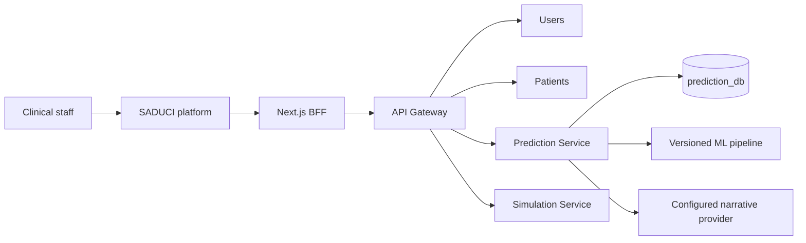
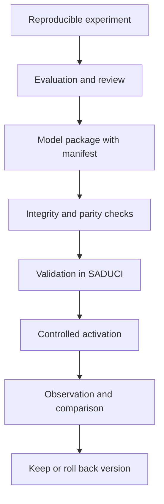

# Moving the prototype into SADUCI: existing integration and remaining updates

Date: November 9, 2026.

Repositories examined: `Intensive-Care-Hidden-Mortality` and `../saduci`.

## 1. Assessment

Basic model integration already exists. SADUCI has a prediction service, shared contracts, persistence, explanations, and narrative generation. Its copy of `new_workflow.joblib` is identical to the one in this repository. The recommended work is to consolidate that integration, correct semantic differences, and establish a reproducible process for future updates.

The proposed arrangement keeps this repository as the research and training workspace and SADUCI as the execution system and clinical decision aid. New versions would be transferred as verifiable model packages with contracts and evaluation evidence. SADUCI would remain the clinical interface.

This document describes the transfer of prototype capabilities into SADUCI and plans updates to that integration. The destination is the public [coslatte/saduci](https://github.com/coslatte/saduci) repository. This contribution does not change SADUCI services, deploy models, or establish clinical validation. It complements [Summary2026.md](Summary2026.md), which records the original experimental work.

### 1.1. Origin, destination, and meaning of the transfer

The starting point is [acferriol/Intensive-Care-Hidden-Mortality](https://github.com/acferriol/Intensive-Care-Hidden-Mortality), which preserves research notebooks, models, explainers, and the Streamlit prototype. The destination for functional integration is [coslatte/saduci](https://github.com/coslatte/saduci), a system covering users, patients, prediction, simulation, and record history.

The documented transfer incorporates predictive capability into SADUCI services and workflows. It does not mean copying every notebook, replacing the original repository, or automatically retiring its application. Experimental provenance remains in this project; integrated execution resides in SADUCI. This separation is the recommended arrangement for continued work, not a maintenance policy agreed between both repositories.

| Original element | Destination in SADUCI | Verified status and scope |
| --- | --- | --- |
| `new_workflow.joblib` | `apps/core/src/prediction/models/v1/new_workflow.joblib` | Incorporated; both files have the same SHA-256. |
| DataFrame preparation and prediction in `web_app.py` | `prediction/app/services/inference.py` | Adapted to service requests using the same six features; execution parity remains to be tested. |
| Streamlit input and presentation | Web platform, BFF, gateway, and `prediction` service | SADUCI has a documented integrated workflow; browser interaction was not verified during this review. |
| Integrated Gradients explainer in `Explainers/` | Local reference impact in `inference.py` | The destination uses a different calculation; equivalent transfer of the original explainers has not been demonstrated. |
| Gemini narrative inside `web_app.py` | `prediction/app/services/narrative.py` and `narrative_model.py` | Adapted to provider selection and local execution; generation requests were not made to verify it. |
| Notebooks and historical results | Research evidence in the original repository | They are not proposed as part of a clinical request, and their migration into SADUCI has not been established. |
| One-off prototype queries | Records in `prediction_db` | SADUCI adds persistence and authorship; model-version provenance and explanation linkage still need completion. |

There are two distinct transfers. The first is functional integration into SADUCI, whose current state and gaps are described here. The second contributes this documentation to the original repository through the [coslatte/Intensive-Care-Hidden-Mortality-SADUCI-Integration](https://github.com/coslatte/Intensive-Care-Hidden-Mortality-SADUCI-Integration) fork and [pull request #6](https://github.com/acferriol/Intensive-Care-Hidden-Mortality/pull/6). That pull request adds reports without moving runtime code or changing either project's deployment.

The plan builds on existing integration. Its purpose is to align inputs, explanations, versions, and records before promoting an updated model. It does not declare the entire project transfer complete or announce archival of the original repository.

## 2. Review scope and method

The review examined SADUCI instructions, architecture documentation, prediction-service sources, contracts, model loading, narrative generation, configuration, entities, and related tests. The code index was used to locate symbols and trace explanation flow. Main queried paths matched index metadata; coverage checks are indicative and do not guarantee completeness.

Artifacts were compared using SHA-256. Models were not deserialized, and training, backend tests, interface tests, containers, and language services were not executed. Frontend review was limited to documentation and locating call sites; interactive behavior must be verified during implementation.

The SADUCI reference is commit `0553b3b`, dated November 6, 2026. Its working tree already contained a change to `apps/core/compose.yaml`. Compose observations describe the local file examined and must be checked against the version eventually integrated.

## 3. Verified integration state

### 3.1. The model is already shared

These files have the same SHA-256:

- `new_workflow.joblib` in this repository.
- `../saduci/apps/core/src/prediction/models/v1/new_workflow.joblib`.

```text
b58bcf14ff4ad023c608861323bcabca5fa5d9250058af9f1ed1d0e1cf1923ad
```

Binary identity removes the need for an initial model copy or conversion. It does not establish equal results across environments: dependency versions, transformations, and inputs still need verification.

### 3.2. Topology to preserve

SADUCI's documented architecture uses a Next.js platform and FastAPI services, with a gateway as their shared boundary. Each data service retains its own PostgreSQL database.



Mortality integration belongs in `Prediction Service`, on internal port 7003. The browser should continue through the BFF and gateway. Direct Streamlit access or browser connections to the internal service are not proposed.

Reference: [SADUCI architecture](https://github.com/coslatte/saduci/blob/0553b3b0e82dcb3584b6662e1417a070530879df/docs/sistema/ARCHITECTURE.md). Some closing notes in that document describe older migration mechanisms, while current backend instructions and the Dockerfile specify Alembic. Planning follows the code and current instructions.

### 3.3. Existing capabilities

| Capability | Observed state | Planning implication |
| --- | --- | --- |
| Inference | `joblib` loading, DataFrame conversion, and `predict_proba`. | Verify and version the existing workflow. |
| Inputs | The same six prototype features. | Reconcile constraints and units. |
| Persisted prediction | Stores features, result, and authorship. | Add model and contract provenance. |
| Explanation | Replaces one feature at a time with a reference value. | Report the actual algorithm accurately. |
| Narrative | `stub`, `embedded`, `local`, `gemini`, and `huggingface` providers. | Reuse existing adapters. |
| Embedded narrative model | Local `llama_cpp` loading and a downloadable asset with checksum. | Separate its availability from ML inference. |
| Contracts | Pydantic in `shared_core/schemas/prediction.py`. | Update contracts and consumers together. |
| Tests | Loading, schema, endpoint, and persistence-failure cases. | Extend observable behavior and parity coverage. |

Sources: `../saduci/apps/core/src/prediction/app/services/ml_model.py:38`, `inference.py:20`, `prediction_service.py:126`, `narrative.py`, `narrative_model.py:25`, and `../saduci/apps/core/tests/prediction/test_prediction_api.py:79`. Line numbers refer to the reviewed tree; function names provide more stable references.

## 4. Gaps the update must resolve

### 4.1. Different constraints on the same inputs

Streamlit accepts age from 0 to 120, APACHE from 0 to 40, and ventilation duration from 1 to 200. It offers diagnosis codes 0 through 48.

SADUCI currently requires these ranges in `PlatformPredictionRequest`:

| Field | Current SADUCI range |
| --- | --- |
| `edad` | 14 to 61 |
| `diag_ing1` | 1 to 20 |
| `diag_ing2` | 0 to 40 |
| `diag_egr2` | 18 to 40 |
| `apache` | 18 to 40 |
| `tiempo_vam` | 18 to 40 |

Sources: `../saduci/apps/core/src/shared_core/schemas/prediction.py:39` and `../saduci/apps/core/src/prediction/app/services/config.py:20`.

The schema should not automatically be widened to Streamlit limits, nor should sample extremes be treated as universal clinical boundaries. First identify the population and input domain actually evaluated. The resulting decision must distinguish format validity, code existence, and membership in the evaluated domain.

For example, an integer age can be structurally valid but outside the studied population. The system should report that condition without clipping the input or inventing a substitute probability.

### 4.2. Display catalog and model codes

The service retains a static 0–48 code map for explanation display and database catalog entities. An auto-incremented catalog identifier must not be assumed equivalent to a training code.

Sources: `../saduci/apps/core/src/prediction/app/services/config.py:33`, `../saduci/apps/core/src/prediction/app/models/entities.py:27`, and `../saduci/apps/core/src/prediction/app/services/diagnoses.py:10`.

The update should establish a verifiable mapping with a stable training code, clinical label, and catalog version. The contract must specify allowed codes for each feature. Translations may change without changing a code's meaning.

### 4.3. Requested and executed explanation methods

`PlatformExplanationRequest` accepts LIME, SHAP, Integrated Gradients, Saliency Maps, and local reference impact. However, `platform_feature_importances(request, _method)` does not use the method to select an algorithm: it replaces each feature with a reference and recalculates probability. `explain_platform_prediction` returns the requested method name.

Sources: `../saduci/apps/core/src/shared_core/schemas/prediction.py:73`, `../saduci/apps/core/src/prediction/app/services/inference.py:71`, and `../saduci/apps/core/src/prediction/app/services/prediction_service.py:162`.

The first update should accurately expose local reference impact and reject unimplemented methods. If SHAP or LIME is added later, it must actually run against the served pipeline and declare its version and configuration.

Serialized explainers from this repository should not be transferred automatically. Reuse first requires demonstrating correspondence with the same estimator and preprocessing. Gradient methods also require an equivalent differentiable representation; parity with the current pipeline has not been established.

### 4.4. References for categorical features

`feature_baseline` calculates the midpoint of numerical limits. For an encoded diagnosis, that midpoint identifies another category rather than a clinical average. Even an existing code requires a justified choice.

Source: `../saduci/apps/core/src/prediction/app/services/inference.py:66`.

A versioned reference profile is proposed. For each diagnosis, it should declare a valid category and rationale, or use a reference strategy compatible with the selected method. Code 0 should not become the default for fields where it is invalid.

### 4.5. Units and prediction time

Newer notebooks convert field-dataset ventilation duration by dividing it by 24. Integration must establish a canonical unit and perform conversion once at the input boundary.

The model also requires a discharge diagnosis. If the intended use is prediction during admission or before that diagnosis exists, the current contract does not meet that objective. A discharge-assessment model must remain distinct from any early-prediction model trained only with information available at its intended prediction time.

This is a design condition derived from required features, not a claim about when each original observation was recorded.

### 4.6. Result provenance and persistence

`PredictionRecord` retains `model_name`, inputs, result, probability under `confidence`, user, and date. It does not declare dedicated columns for model version, checksum, or input-schema version.

Source: `../saduci/apps/core/src/prediction/app/models/entities.py:11`.

Platform creation returns `persisted=False` when saving fails. The distinction between a calculated result and a recorded result must remain visible. Mortality probability should also be distinguished from a separate confidence or uncertainty measure.

### 4.7. Narratives and availability

The prototype calls Gemini directly. SADUCI already offers several providers and a deterministic template. The code defaults to `stub`, while the examined local Compose defaults to `embedded`. This difference must be explicit for each environment.

The embedded branch falls back to a template when its model is unavailable. Other provider calls can propagate errors. The proposed behavior preserves probability and structured explanation when the optional narrative fails.

Timeouts require end-to-end review. Existing client explanation calls with a 30-second timeout and providers configured for 60 seconds were located. The client actually used by each active screen must be verified before adjusting these values.

Sources: `../saduci/apps/core/src/prediction/app/services/config.py:85`, `narrative.py`, `../saduci/apps/platform/src/lib/prediction.ts:209`, and `../saduci/apps/core/compose.yaml:159`.

## 5. Recommended architecture

### 5.1. Alternatives considered

| Alternative | Benefit | Cost or limitation | Decision |
| --- | --- | --- | --- |
| Link or embed Streamlit in SADUCI | Quickly preserves the visual prototype. | Duplicates input capture, sessions, deployment, and narrative configuration. | Retain only as a research tool. |
| Update the existing `prediction` service | Reuses contracts, authorship, history, and network boundary. | Requires semantic corrections and parity checks. | Recommended. |
| Create an independent inference service | Isolates runtime and model scaling. | Adds networking, operations, and contracts for an already served model. | Defer until a concrete need is demonstrated. |

### 5.2. Ownership

| Component | Proposed responsibility |
| --- | --- |
| This repository | Reproducible preparation, experiments, training, evaluation, and export. |
| `prediction` | Input validation, inference, explanations, optional narrative, and result storage. |
| `shared_core` | Shared public contracts and transport types. |
| `patient` | Patient identity and its clinical data responsibilities; no model loading. |
| Gateway | Authentication, authorization, routing, and user context. |
| Platform | Input capture, presentation, error states, and record history. |
| `simulation` | Retain current responsibilities; future predictor use requires its own contract. |

Sharing tables across service databases or loading models in `shared_core` is not proposed. Inference rules should have one owner: the prediction service.

### 5.3. Model update flow



The package is incorporated through a reviewable change. Training must not run within a clinical request, and arbitrary user-supplied predictive models must not be downloaded.

## 6. Proposed contracts

Names in this section are proposals, not implemented endpoints or fields.

### 6.1. Model package

Each version should include:

```text
models/<version>/
  new_workflow.joblib
  manifest.json
  evaluation.json
  reference_profile.json
```

The manifest should declare `model_id`, `model_version`, `artifact_sha256`, training commit, runtime versions, feature order and types, ventilation unit, catalog version, positive class, threshold, and available explanation methods. `evaluation.json` must separate reproduced metrics from historical outputs awaiting reproduction.

A training-dataset identifier should enable traceability without including personal data or publishing the clinical dataset. A checksum verifies integrity; trusting an artifact also requires knowing and reviewing its provenance.

### 6.2. Consumer usage

The platform would continue using the current prediction route. The proposal enriches responses and links explanations to a specific result:

```text
result = predict(inputs, optional_patient)
explanation = explain(result.prediction_id, available_method)
```

The explanation then uses the original result's inputs and model version. Changing the form requires another prediction. For unpersisted results, define a controlled temporary identifier or request an explicit new calculation; do not imply that a saved record exists.

### 6.3. Prediction response

Proposed additions are `prediction_id`, `model_version`, `artifact_sha256`, `input_schema_version`, `catalog_version`, `reference_profile_version` where applicable, `computed_at`, and domain warnings.

Probability must be finite and within `[0,1]`. Identify the positive class using estimator classes and the manifest, rather than only fixed position `[1]`. Non-finite output must be treated as inference failure instead of being clipped into an apparently valid probability.

### 6.4. Explanation response

Proposed fields are `requested_method`, `effective_method`, `explainer_version`, `prediction_id`, `model_version`, references used, structured contributions, and narrative status.

Do not assume substitution differences sum to the prediction probability. They are individual contrasts against references. Any additional algorithm must declare its units and properties rather than reuse an incompatible mathematical description.

An unavailable method should return an explicit contract error listing supported methods. A different method must not be returned under the requested name.

### 6.5. Compatible evolution

Update consumers to understand metadata and capabilities first, then restrict method selection. Existing English and Spanish route aliases should remain during that transition. Later removal requires checking consumers without indefinitely retaining duplicate logic implementations.

## 7. Persistence and migrations

An Alembic migration is proposed to associate provenance with new predictions. Exact fields depend on the final contract; at minimum, each result must identify its producing version and checksum.

Historical records should be marked as having unknown provenance unless evidence links them to an artifact. They must not automatically receive the current version. Their probabilities must not be recalculated or overwritten as part of a schema migration.

If explanations are stored, they must link to the prediction, effective method, and references. Retained narratives should identify provider, model, and prompt version. A retention policy must determine which generated text needs storage and which can be reconstructed.

Test the migration against a schema copy with representative synthetic data, verify historical reads, and check application rollback. Rolling back code must not require deleting new columns or results.

## 8. Phased execution plan

Each phase has a verifiable exit gate. Fixed dates are not assigned because environment reproduction and data availability remain unverified. The sequence separates scientific updates from contract corrections.

| Phase | Work | Deliverable | Exit criterion |
| --- | --- | --- | --- |
| 0. Baseline | Capture commits, local diff, checksums, dependencies, and active request path. | Inventory and synthetic reference cases. | The compared system can be identified exactly. |
| 1. Input semantics | Resolve units, prediction time, ranges, and codes. | Six-feature specification and mappings. | Backend, interface, and model interpret each value consistently. |
| 2. Accurate explanations | Expose reference impact with valid references. | Coherent contract and UI; unimplemented methods rejected. | Displayed method identifies the executed algorithm. |
| 3. Reproducible package | Export manifest, evaluation, and reference profile. | Verifiable version of the current model. | Inference parity and loading in the SADUCI runtime pass. |
| 4. Traceability | Metadata, result identifier, and explanation linkage. | Updated migration and contracts. | New results are reconstructible and historical information is preserved. |
| 5. Narrative and experience | Controlled degradation, deadlines, and partial states. | Complete workflow in the existing platform. | Generator failure does not invalidate prediction. |
| 6. Integrated validation | Contracts, roles, persistence, parity, and failure paths. | Reproducible acceptance evidence. | Agreed technical criteria pass locally. |
| 7. Scientific update | Retraining and evaluation of new variants. | Candidate with documented metrics and domain. | Promotion is justified by independent evaluation. |
| 8. Activation | Pinned version, observation, and rehearsed rollback. | Controlled deployment of the accepted candidate. | Previous artifacts can be restored without losing history. |

Phases 1–6 can initially retain the byte-identical model. Phase 7 begins only when adequate data and evaluation conditions exist. Technical integration must not be presented as a demonstrated improvement in predictive performance.

## 9. Concrete work by location

| Location | Planned change |
| --- | --- |
| This repository, alongside experiments | Add reproducible export and evaluation commands, choosing their location before implementation. |
| `saduci/apps/core/src/prediction/models/` | Keep approved artifacts and a manifest per version. |
| `prediction/app/services/ml_model.py` | Validate manifest, integrity, classes, and compatibility during loading. |
| `prediction/app/services/inference.py` | Validate outputs, reference profile, and effective methods. |
| `prediction/app/services/prediction_service.py` | Return provenance and link explanations to results. |
| `shared_core/schemas/prediction.py` | Define updated contracts and capabilities without duplicating policy across transports. |
| `prediction/app/models/entities.py` and `prediction/migrations/` | Add traceability and preserve historical data through Alembic. |
| `prediction/app/services/narrative.py` | Optional status, error policy, and consistent prompts across providers. |
| Existing platform prediction module and BFF | Update types, forms, method selection, and history after confirming active clients. |
| `saduci/docs/sistema/` | Document final contracts, units, activation, and rollback in the canonical location. |

This table assigns technical responsibilities, not concurrent agents. Implementation must follow local reservations and coordination if parallel work is later used. Compose changes belonging to another session must not be overwritten.

## 10. Testing and acceptance strategy

### 10.1. Current-model parity

Create synthetic cases without patient data covering all allowed categories and agreed limits. Compare the reference pipeline and service using identical inputs. Set and record numerical tolerance after checking determinism and runtime, before evaluating a candidate.

Verify column order, categorical transformation, ventilation unit, positive class, finite probabilities, and consistent threshold application. Include the exact threshold to detect rounding differences.

### 10.2. Contracts and explanations

Check missing fields, unknown codes, and out-of-domain values. Using a controlled model with a known feature dependency, verify that calculated impact matches the documented substitution and displayed direction.

Every method declared available must execute its algorithm and return its effective name. Explaining a stored prediction after activating another version must use the original version or explicitly report its unavailability.

### 10.3. Persistence, identity, and failures

Verify saved predictions, database failure with `persisted=False`, historical data with unknown versions, and retries. If idempotency is added, bind its key to the user and request to prevent accidental duplicate records.

Permission checks must traverse the BFF and gateway rather than only the internal router. Roles and patient associations must retain SADUCI's existing policies.

### 10.4. Narrative and interface

Test disabled generation, an absent local model, remote timeout, and invalid responses. Already calculated numerical results must remain available, with clear explanation and persistence states.

Changing an input must invalidate the previous explanation or require another prediction. Controls must support keyboard access, visible focus, and SADUCI's visual patterns. Text and translation review must follow the project's actual structure.

### 10.5. Planned commands

These commands come from SADUCI instructions and are intended for implementation. They were not run for this report:

```bash
# From the SADUCI repository root
python scripts/saduci.py test

# From apps/core
uv run ruff check .

# From apps/platform
bun run test
bunx tsc --noEmit
bun run lint
```

Integrated acceptance must include a real browser → BFF → gateway → service test. Platform builds remain subject to repository rules, which do not require them by default.

## 11. Scientific model update

The first delivery should organize and verify the existing model. A second can evaluate a replacement while keeping those objectives separate.

Candidate evaluation requires reconstructing provenance and labels, splitting data before resampling, and reserving an independent evaluation. Diagnoses must be treated as categories, and synthetic observations must preserve their meaning. Explanation reference data must be authorized and representative.

Metrics should include probability-based discrimination, sensitivity, precision, specificity, F1, calibration, and uncertainty where sample size permits. Historical label-based figures should remain identified as historical evidence and not be compared as though they measured the same quantity.

The small number of deaths in saved field tests prevents promotion based solely on recall of 1.00. Evaluation must report absolute case counts and false alerts. Promotion criteria and intended clinical use must be agreed before examining the candidate's final results.

Language-generated treatment recommendations are not proposed, and narratives must not be presented as causal explanations of patient outcomes. SADUCI should present a clinical assessment aid with result provenance and limitations.

## 12. Operations, promotion, and rollback

Select the active version explicitly through configuration and verify it at startup. Prediction readiness should depend on a loaded, compatible pipeline. Narrative-generator availability should be reported separately.

Record version, checksum, inference duration, operational errors, and persistence status without placing clinical inputs or full prompts in general logs. Remote providers must be enabled according to environment configuration and authorization; this plan activates none.

Before promotion, preserve the previous artifact, manifest, and synthetic parity cases. Rollback selects that version without overwriting predictions already made by the new one. If a historical explanation requires a retired model, report that condition rather than silently regenerating it using another model.

Queues or a separate language service should be introduced only if concurrency and latency measurements show that current execution cannot meet the intended use. First measure actual timings and their limits.

## 13. Risks and pending decisions

| Risk or decision | Priority | Proposed resolution |
| --- | --- | --- |
| Requested method differs from executed method | P0 | Declare and execute the effective method before adding explainers. |
| Catalog identifier differs from training code | P0 | Exhaustive mapping and correspondence tests. |
| Ambiguous ventilation units | P0 | Canonical unit and verified single conversion. |
| Discharge diagnosis unavailable for early prediction | P0 | Define prediction time or train a separate variant. |
| Ranges lack domain justification | P0 | Document population, format, and evaluated limits separately. |
| Model and explanation lack version linkage | P1 | Manifest and result traceability. |
| Narrative failure hides a valid result | P1 | Partial state and explicit degradation. |
| Updates break historical records | P1 | Compatible migration and unknown provenance where evidence is absent. |
| Apparent improvement from leakage or small evaluations | P1 | Reproducible evaluation before candidate promotion. |
| Unnecessary operational complexity | P2 | Reuse the service and measure before separating it. |

P0 blocks semantically reliable integration; P1 completes traceability and robustness; P2 concerns later evolution. These priorities are proposals in this report.

Three product and data decisions must be resolved before implementation: prediction time, the version's target population, and the policy for external narratives. These can be documented during phases 0 and 1 without stopping the technical inventory or parity tests.

## 14. Recommended first delivery

The first delivery should retain the current checksum, describe reference impact accurately, establish units and diagnosis mappings, and return model provenance. Next, complete record linkage and narrative fault tolerance.

This sequence improves integration without attributing unmeasured performance gains to the model. Retraining remains a separate delivery with its own evaluation and explicit promotion decision.

## 15. Main internal sources

- [Original project summary](Summary2026.md).
- [SADUCI architecture](https://github.com/coslatte/saduci/blob/0553b3b0e82dcb3584b6662e1417a070530879df/docs/sistema/ARCHITECTURE.md).
- [SADUCI instructions](https://github.com/coslatte/saduci/blob/0553b3b0e82dcb3584b6662e1417a070530879df/AGENTS.md).
- [Prediction contract](https://github.com/coslatte/saduci/blob/0553b3b0e82dcb3584b6662e1417a070530879df/apps/core/src/shared_core/schemas/prediction.py).
- [Inference and reference impact](https://github.com/coslatte/saduci/blob/0553b3b0e82dcb3584b6662e1417a070530879df/apps/core/src/prediction/app/services/inference.py).
- [Prediction, explanation, and persistence](https://github.com/coslatte/saduci/blob/0553b3b0e82dcb3584b6662e1417a070530879df/apps/core/src/prediction/app/services/prediction_service.py).
- [Pipeline loading](https://github.com/coslatte/saduci/blob/0553b3b0e82dcb3584b6662e1417a070530879df/apps/core/src/prediction/app/services/ml_model.py).
- [Configuration and codes](https://github.com/coslatte/saduci/blob/0553b3b0e82dcb3584b6662e1417a070530879df/apps/core/src/prediction/app/services/config.py).
- [Narrative generation](https://github.com/coslatte/saduci/blob/0553b3b0e82dcb3584b6662e1417a070530879df/apps/core/src/prediction/app/services/narrative.py).
- [Local narrative model](https://github.com/coslatte/saduci/blob/0553b3b0e82dcb3584b6662e1417a070530879df/apps/core/src/prediction/app/services/narrative_model.py).
- [Narrative asset and checksum](https://github.com/coslatte/saduci/blob/0553b3b0e82dcb3584b6662e1417a070530879df/apps/core/src/prediction/app/services/model_assets.py).
- [Persisted entities](https://github.com/coslatte/saduci/blob/0553b3b0e82dcb3584b6662e1417a070530879df/apps/core/src/prediction/app/models/entities.py).
- [Service tests](https://github.com/coslatte/saduci/blob/0553b3b0e82dcb3584b6662e1417a070530879df/apps/core/tests/prediction/test_prediction_api.py).

SADUCI links point to the reference commit on GitHub. The repository is public at [coslatte/saduci](https://github.com/coslatte/saduci), so linked sources can be consulted without private access. The report distinguishes local review observations from implementation proposals. Paths beginning with `../saduci` describe the local layout used during review. This report is contributed to the research repository through a fork; final operational documentation belongs in SADUCI's canonical location when changes are implemented.
